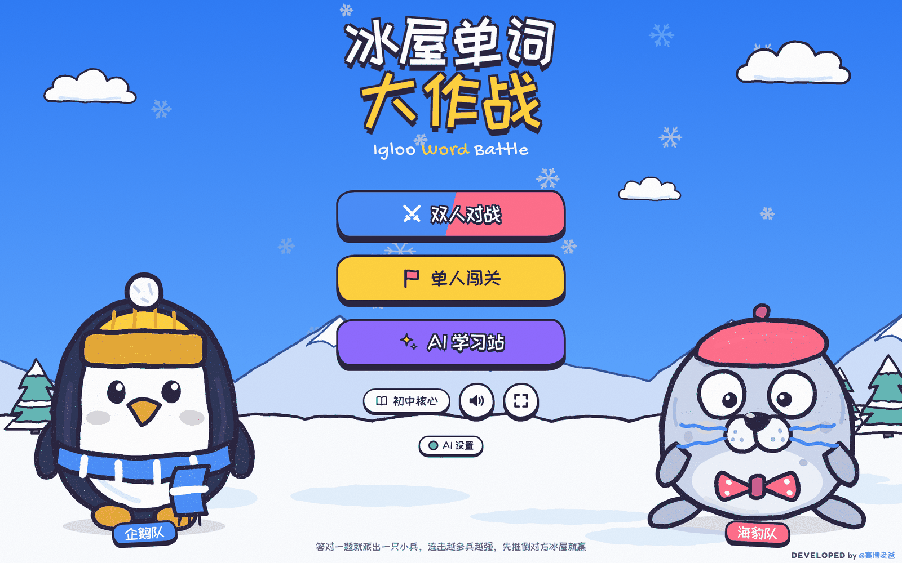
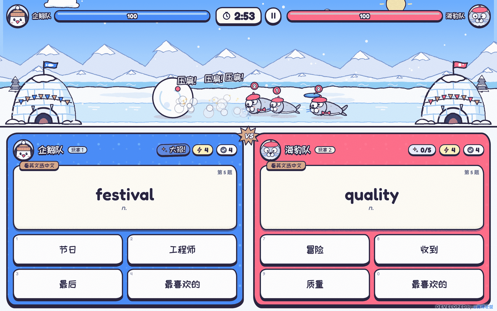
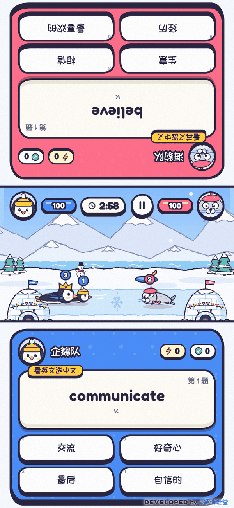
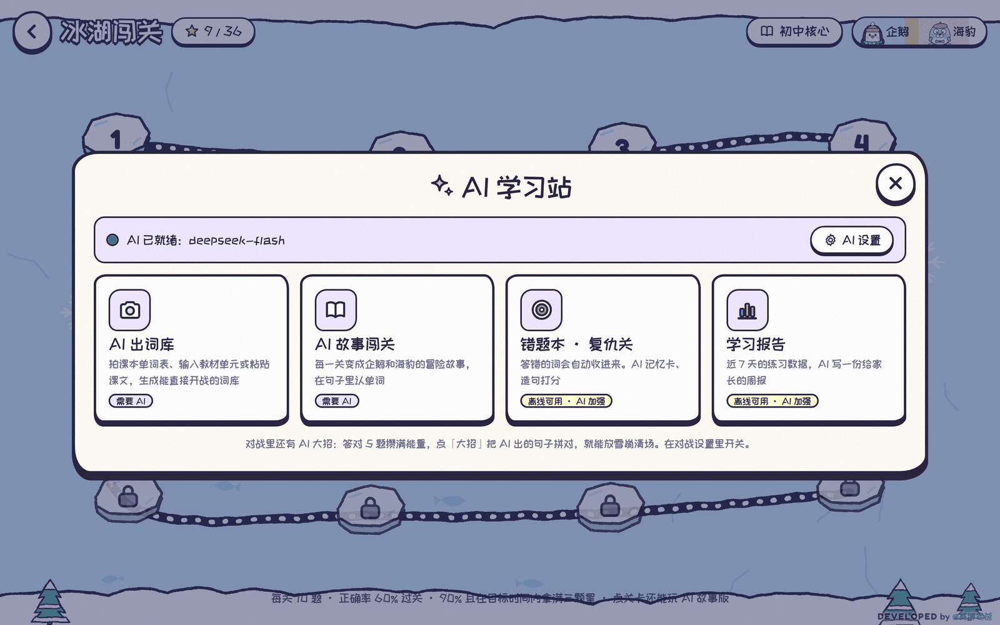
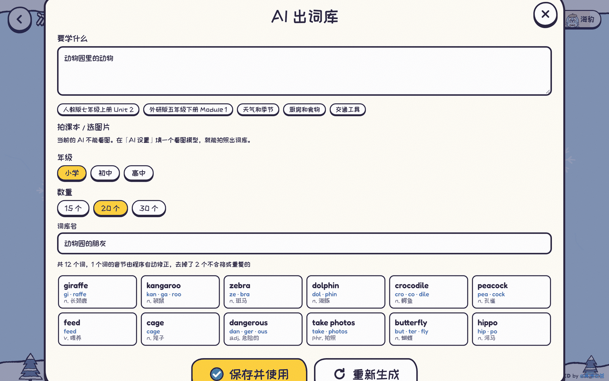
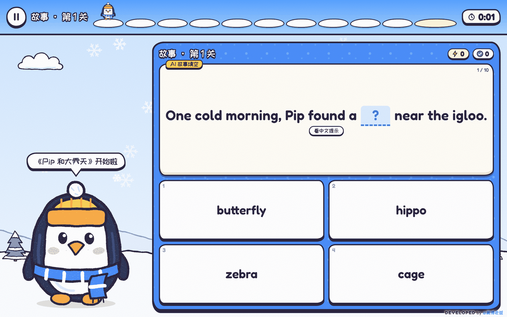
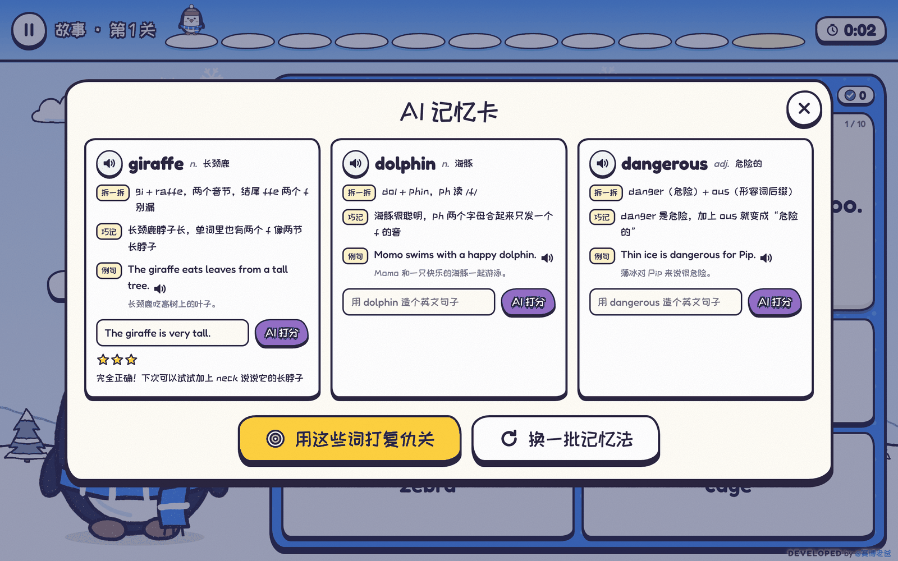
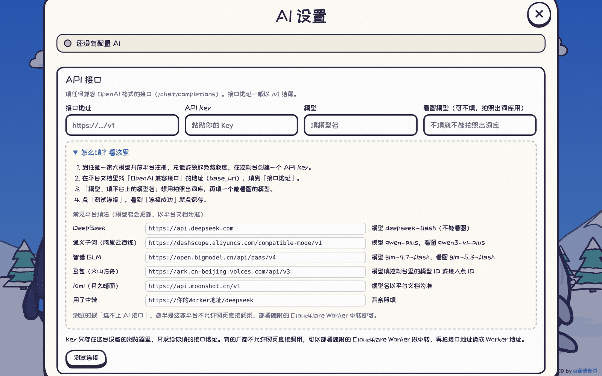

# English Study Game · 冰屋单词大作战

> 英语单词学习游戏 · Igloo Word Battle
>
> DEVELOPED by **@赛博老爸**

企鹅队 vs 海豹队的英语单词对战小游戏。答对一题，就从自家冰屋派出一只小兵滑向对面；连击越多兵越强，先推倒对方冰屋的一方获胜。

- 手绘卡通画风，所有角色和场景都由代码实时绘制，没有图片素材
- 双人同屏对战 / 人机对战 / 12 关单人闯关
- 支持触屏，教室一体机大屏、平板、手机都能玩；手机竖屏时两人面对面各点一边
- 一个 HTML 文件，不用安装、不用构建，双击打开就能玩
- 填上自己的大模型 API 后，解锁 AI 出词库、AI 故事闯关、AI 记忆卡、AI 大招、AI 学习周报

适合亲子练习、同学对战、课堂互动和个人单词复习。游戏界面以中文为主，练习内容为英语词汇；基础玩法无需注册账号，也无需配置 AI。

**[完整使用指南](docs/USER_GUIDE.md)** · **[下载代码包](https://github.com/cyberdaddyleo/English-study-game/archive/refs/heads/main.zip)** · **[MIT 许可证](LICENSE)**

## 软件说明

| 项目 | 说明 |
| --- | --- |
| 软件名称 | English Study Game / 冰屋单词大作战 |
| 运行方式 | 浏览器打开 `index.html`，也可部署到静态网站 |
| 游戏模式 | 双人同屏、电脑对战、12 关单人闯关 |
| 学习内容 | 中英互选、单词补全、音节拼词、听音选词 |
| 内置词库 | 冰雪冬日 50 词、小学核心 60 词、初中核心 60 词 |
| 扩展词库 | 手动粘贴词表；配置 AI 后可生成词库或识别单词表图片 |
| 学习反馈 | 错题本、复仇关、近 7 天学习统计、可选 AI 记忆卡与周报 |
| 技术形式 | HTML + CSS + 原生 JavaScript；游戏无 npm 依赖、无构建步骤 |
| 数据保存 | 当前浏览器本地保存，无账号系统、无跨设备同步 |
| 开源协议 | MIT，保留原作者版权与许可声明 |



| 双人对战 | 手机竖屏：面对面对战 |
| --- | --- |
|  |  |

---

## 目录

- [快速开始](#快速开始)
- [完整使用指南](docs/USER_GUIDE.md)
- [玩法](#玩法)
- [AI 功能](#ai-功能)
- [配置 AI 接口](#配置-ai-接口)
- [AI 接口中转（可选）](#ai-接口中转可选)
- [词库](#词库)
- [技术说明](#技术说明)
- [项目结构](#项目结构)
- [隐私](#隐私)
- [作者](#作者)
- [许可](#许可)

---

## 快速开始

### 下载后直接玩

1. 点击仓库右上方绿色 **Code → Download ZIP**，或使用上方“下载代码包”。
2. 解压后，使用浏览器打开根目录的 `index.html`。不要在 GitHub 源码页里尝试玩游戏。
3. 点击首页显示当前词库名称的按钮，选择适合的词库。
4. 一个人玩：点「单人闯关」→ 第 1 关 →「开始闯关」。两个人玩：点「双人对战」→「好友同屏」→「开战！」，双方点击「点我准备」后开始。

基础游戏可在本地运行；联网时会尝试加载在线字体，加载失败会使用系统字体。AI 功能需要网络和自行配置的接口。

### 用 Git 下载

```bash
git clone https://github.com/cyberdaddyleo/English-study-game.git
cd English-study-game
```

然后用浏览器打开 `index.html`。如已安装 Python 3，也可在此目录执行 `python3 -m http.server 8000 --bind 127.0.0.1`，再访问 `http://127.0.0.1:8000/`；Python 不是游戏必需依赖。

### 发布为在线游戏（可选）

仓库管理员可在 **Settings → Pages** 中，将 Source 设为 **Deploy from a branch**，分支选 `main`，目录选 `/ (root)`，保存后等待部署成功。最终网址以 Pages 设置页显示为准。参见 [GitHub Pages 官方配置说明](https://docs.github.com/en/pages/getting-started-with-github-pages/configuring-a-publishing-source-for-your-github-pages-site)。

> 上传仓库本身不会自动开启在线游戏。使用 AI 时建议通过 HTTPS 网站访问；本地 `file://` 页面或目标平台的跨域策略可能阻止请求。详细步骤见[使用指南](docs/USER_GUIDE.md)。

---

## 玩法

### 双人对战

- 两队各答各的题，同一题号采用相同题型，出词顺序尽量错开；特殊自定义词库可能出现相同单词
- 答对：派出一只小兵。连对 3 题派出戴围巾的大号兵（战力 2），连对 6 题派出戴皇冠的兵（战力 3）
- 两边小兵相撞会互相抵消战力，剩下的继续前进；冲到对方冰屋造成「战力 × 5」点伤害
- 答错：答题板冻住约 2 秒，同时显示正确答案（乱点会吃亏）
- 冰屋 100 血，先推倒对方获胜；时间到（2 / 3 / 5 分钟可选）先比剩余血量，同血量再比答对题数，仍相同则平局
- 对手可选「好友同屏」或「电脑」（简单 / 普通 / 困难）
- 题型档位：轻松（中英互选）/ 标准（+补全单词）/ 全能（+音节拼词）

### 单人闯关

- 每个词库 12 关，每关 10 题，过关解锁下一关
- 正确率 60% 过关，80% 两星，90% 且在目标时间内三星
- 后面的关卡会出现「听音选词」「补全单词」「音节拼词」
- 结算页列出答错的单词，点一下听发音

### 题型

| 题型 | 说明 |
| --- | --- |
| 看英文选中文 | 四选一 |
| 看中文选英文 | 四选一，干扰项优先选拼写相近的词 |
| 补全单词 | 挖掉一个音节或字母块，从易混拼写里选对的 |
| 音节拼词 | 看中文，按顺序点音节块拼出单词 |
| 听音选词 | 用浏览器朗读单词，选出听到的词（闯关模式） |

### 键盘（可选）

- 对战：企鹅队 `1` `2` `3` `4`，海豹队 `7` `8` `9` `0`，`Esc` 暂停
- 闯关：`1` `2` `3` `4` 选答案，`Esc` 暂停

---

## AI 功能

首页点「AI 学习站」进入。带「需要 AI」标记的功能要先在「AI 设置」里填好接口。

| 功能 | 说明 | 需要 AI |
| --- | --- | --- |
| AI 出词库 | 输入教材单元（如「人教版八年级上册 Unit 3」）、一个主题，或粘贴课文；也可以拍单词表。生成后程序会校验每个词（音节必须拼回原词、去重、去掉不合格的），预览后保存成词库 | 是 |
| AI 故事闯关 | 每一关都有「AI 故事版」：把本关 10 个词编进企鹅 Pip 和海豹 Momo 的冒险故事，选词填空；中文翻译默认隐藏，可点开提示；结束后可看全文、朗读全文。故事缓存在本地，重玩同一个已缓存故事通常无需再次生成 | 是 |
| 错题本 · 复仇关 | 答错的词自动收进错题本，同一个词连续答对 2 次自动移出；复仇关只考这些词 | 否 |
| AI 记忆卡 · 造句打分 | 为错词生成「拆一拆 / 巧记 / 例句」；可以自己用这个词造句，AI 打 0–3 星并给出改正句 | 是 |
| AI 大招（对战） | 答对 5 题攒满能量，点「大招」把 AI 出的句子按顺序拼出来；拼对就滚出大雪球，压扁对面所有小兵并砸冰屋 15 点。电脑对手也会放大招。可在对战设置里关闭 | 是 |
| 学习报告 | 近 7 天的局数、答题数、正确率、每日答题量与最常错的词，以及累计各题型正确率；AI 写一份给家长的周报，一键复制 | 数据不需要，周报需要 |



| AI 出词库 | AI 故事闯关 |
| --- | --- |
|  |  |



> 截图里的 AI 内容是示例，实际内容由你配置的模型生成。

---

## 配置 AI 接口

首页点「AI 设置」，填四项：

| 字段 | 说明 |
| --- | --- |
| 接口地址 | OpenAI 兼容接口的 base_url，一般以 `/v1` 结尾。程序会自动拼上 `/chat/completions` |
| API Key | 在平台控制台创建 |
| 模型 | 平台上的模型名 |
| 看图模型 | 可不填。填了才能「拍照出词库」 |

填好点「测试连接」，看到「连接成功」再点保存。

接口地址和模型 ID 请从所用服务商的控制台或官方文档复制。游戏设置页与原始截图中的模型名称仅为示例，不代表当前可用型号；本项目不内置 API Key，也不包含模型调用额度。测试连接和生成内容可能消耗服务商额度。

仅使用文字功能时，「看图模型」可留空；拍照出词库需要单独填写支持图片输入的模型。

**接口要求**：

- 请求格式：`POST {接口地址}/chat/completions`，`Authorization: Bearer <Key>`，OpenAI Chat Completions 格式
- 看图：图片以 `image_url`（base64 data URL）传入，需要模型支持
- 模型需要能按要求输出 JSON（程序会容错解析代码块里的 JSON，并对内容做校验）



---

## AI 接口中转（可选）

有些平台不允许网页直接调用接口（浏览器跨域被拦），测试时会提示「连不上 AI 接口」。这时部署 `worker/ai-proxy-worker.js` 到 Cloudflare Workers 做中转：

1. 登录 Cloudflare → `Workers & Pages` → `Create` → 创建一个 Worker
2. 把 `worker/ai-proxy-worker.js` 的内容粘贴进去，部署
3. Worker 的 `Settings → Variables and Secrets` 中添加文本变量：`ALLOW_ORIGIN = https://你的游戏域名`，保存并部署。只填写来源（协议 + 域名 + 可选端口），不带仓库路径或末尾斜杠
4. 游戏「AI 设置」里，接口地址改成 `https://<你的worker域名>/<平台名>`，其余照填

| 平台名 | 转发到 |
| --- | --- |
| `deepseek` | `https://api.deepseek.com` |
| `qwen` | `https://dashscope.aliyuncs.com/compatible-mode/v1` |
| `zhipu` | `https://open.bigmodel.cn/api/paas/v4` |
| `ark` | `https://ark.cn-beijing.volces.com/api/v3` |
| `moonshot` | `https://api.moonshot.cn/v1` |

例：`https://igloo-ai.xxx.workers.dev/deepseek`

随附 Worker 源码没有持久化 API Key 的逻辑，但会接收请求内容及 Key，并转发给上游服务。`ALLOW_ORIGIN` 用于限制浏览器跨域来源，不是身份认证或完整的滥用防护；默认未设置时允许任意来源。使用 GitHub Pages 时，来源应填写 `https://cyberdaddyleo.github.io`，不要附加 `/English-study-game/`。

上表是随附脚本中预设的路由。服务商接口如有变更，需按官方文档更新脚本顶部的 `TARGETS`。变量配置参考 [Cloudflare Workers 官方说明](https://developers.cloudflare.com/workers/configuration/environment-variables/)。

---

## 词库

内置三套：冰雪冬日（50 词）、小学核心（60 词）、初中核心（60 词）。

**自己的词表**：「词库 → 我的词表」，每行一个，至少 8 个词：

```
pi-o-neer n. 先驱
engineer n. 工程师
curiosity 好奇心
shake hands with 与某人握手
```

- 格式：`单词 词性(可省) 中文`，也支持逗号或 Tab 分隔
- 想手动分音节，用 `-` 连起来；不分的话程序会自动切分
- 短语会按单词拆成拼词块

**修改内置词库**：在 `index.html` 里搜索 `var BANKS`，每个词一行，格式为 `音-节-拆-分|词性|中文`。

---

## 技术说明

- **单文件**：HTML + CSS + 原生 JavaScript，无框架、无 npm 依赖、无构建步骤；在线字体为可选外部资源
- **画面**：角色、冰屋、雪地全部是代码生成的 SVG，用 SVG 滤镜（feTurbulence + feDisplacementMap）做出手绘抖动和蜡笔颗粒；对战场地用 Canvas 绘制小兵和特效
- **声音**：Web Audio 实时合成音效；单词发音用浏览器自带的语音合成（speechSynthesis）
- **字体**：ZCOOL KuaiLe、Fredoka、Gochi Hand，来自 Google Fonts（均为 OFL 开源授权）。在无法访问 Google Fonts 的网络环境下会自动回退到系统字体，游戏照常运行；想保留手写字体，可以把字体文件下载到仓库里，改成本地 `@font-face`
- **存储**：进度、词库、错题本、学习记录、AI 设置都存在浏览器 `localStorage`（键名 `igloo-word-battle-v1`）；存储被禁用时自动退回内存，不影响游玩
- **浏览器环境**：建议使用近期版本的 Chrome、Edge、Safari 或 Firefox；语音、全屏、多点触控等能力取决于设备和浏览器。未对所有机型或旧版本作兼容性保证
- **多点触控**：答题按钮用 `pointerdown` 响应，两个人同时点互不干扰

`index.html` 里的代码分块：

| 模块 | 作用 |
| --- | --- |
| `BANKS` / `parseCustom` / `syllabify` | 内置词库、自定义词表解析、自动音节切分 |
| `ART` | 企鹅、海豹、小兵、冰屋的 SVG 绘制和手绘滤镜 |
| `SCENE` | 首页、对战场地、闯关地图的背景 |
| `SND` | 音效合成与单词朗读 |
| `AI` | 大模型接口调用、提示词、结果校验 |
| 主逻辑 | 出题、答题板、对战引擎、闯关、AI 功能界面 |

---

## 项目结构

```
English-study-game/
├── index.html                 # 游戏本体（单文件）
├── worker/
│   └── ai-proxy-worker.js     # 可选：AI 接口中转（Cloudflare Worker）
├── docs/
│   ├── USER_GUIDE.md          # 完整使用方法与常见问题
│   └── screenshots/           # README 截图
├── README.md                 # 软件说明与快速开始
├── .gitignore
├── .nojekyll                 # 可选 GitHub Pages 静态发布支持
└── LICENSE
```

---

## 隐私

- 游戏不含账号系统或项目自建的数据收集后端。学习记录、进度、词表、AI 缓存和 AI 设置保存在当前浏览器的 `localStorage` 中，不会自动同步到其他设备。
- API Key 以明文存储于浏览器本地，输入框的掩码不等于加密。不要把 Key 写进代码或上传仓库；在共用设备上使用完毕后，可清空「AI 设置」中的 Key 并保存。
- 使用 AI 时，相关单词、提示词、句子、学习统计或选取的图片会按功能需要发送到配置的接口，Key 会随认证请求发送。若配置 Worker 中转，请求还会经过该 Worker 和模型服务商。
- 页面会请求 Google Fonts；单词朗读使用浏览器的语音服务，其是否联网取决于所选语音和系统实现。使用在线托管版时还会访问对应托管服务。
- 清除浏览器站点数据会删除本地记录。切换浏览器、设备、域名或本地/在线入口时，记录可能不共享。存储不可用时退回内存，刷新或关闭页面后不能保证保留。

---

## 作者

DEVELOPED by **@赛博老爸**

## 许可

[MIT](LICENSE)
