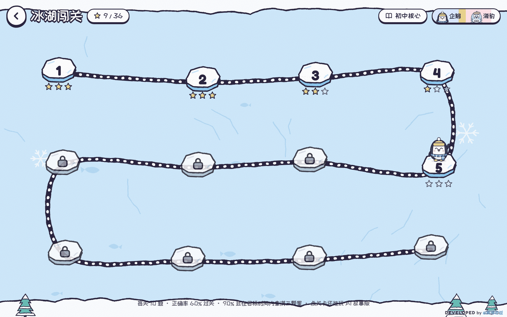

# English Study Game 使用指南

本指南适用于「冰屋单词大作战 · Igloo Word Battle」，由 **@赛博老爸** 开发。软件介绍和界面截图见 [README](../README.md)。

## 1. 第一次打开

1. 在 [GitHub 仓库](https://github.com/cyberdaddyleo/English-study-game) 点击 **Code → Download ZIP**。
2. 解压文件，用浏览器打开根目录的 `index.html`。无需安装软件、注册账号或运行构建命令。
3. 首页有「双人对战」「单人闯关」「AI 学习站」。下方显示当前词库名称的按钮用于切换词库，旁边有音效和全屏按钮。
4. 初次使用建议选择「小学核心」或「冰雪冬日」，先玩普通闯关。未配置 AI 也能进行基础练习。

如果双击打开的是文本编辑器，请对 `index.html` 使用“打开方式”，选择浏览器。GitHub 的代码浏览页面只显示源码，需要下载后打开，或由管理员配置静态网站。

## 2. 双人同屏与电脑对战

首页点击「双人对战」，在「对战设置」里依次选择：

| 设置项 | 可选内容 |
| --- | --- |
| 对手 | 好友同屏、电脑 · 简单、电脑 · 普通、电脑 · 困难 |
| 时长 | 2 分钟、3 分钟、5 分钟 |
| 题型 | 轻松：中英互选；标准：加入补全单词；全能：再加入音节拼词 |
| AI 大招 | 开 / 关；需要配置 AI 才能使用 |
| 词库 | 点击当前词库按钮更换 |

选好后点击「开战！」，再点击各自一侧的「点我准备」，倒计时后开始。同屏两人分别控制企鹅队和海豹队；选择电脑时，电脑控制海豹队且自动准备。此处的电脑对手不需要大模型接口。

- 答对一题派出一只小兵。连续答对达到 3 题时战力升为 2，达到 6 题时升为 3；答错会中断连击。
- 双方小兵相撞会抵消战力，存活的小兵继续前进。抵达对方冰屋，造成“剩余战力 × 5”的伤害。
- 答错会短暂冻结答题板并提示正确答案，约 2 秒后继续答题。
- 冰屋初始生命值为 100。先摧毁对方冰屋获胜；时间结束时先比较剩余生命值，同血量再比答对题数，仍相同则平局。
- 手机竖屏会采用面对面的上下布局。双人对战是同一台设备上的互动，不支持两台手机远程联机。

键盘操作：企鹅队 `1 / 2 / 3 / 4`，海豹队 `7 / 8 / 9 / 0`；`Esc` 暂停。也可以点击或触摸选项。

## 3. 单人闯关

1. 首页点击「单人闯关」，进入关卡地图。
2. 可选择企鹅或海豹形象，然后点击已解锁的关卡。
3. 先查看本关单词和题型，再点击「开始闯关」。
4. 每关完成 10 题后查看成绩和错词；点击错词可尝试听发音。

每个词库有 12 关，通过当前关卡后解锁下一关。词表较小时，单词可能在题目中重复出现。

| 星级 | 条件 |
| --- | --- |
| 1 星，通过 | 正确率至少 60% |
| 2 星 | 正确率至少 80% |
| 3 星 | 正确率至少 90%，且用时不超过本关目标时间 |

后续关卡逐步加入听音选词、补全单词和音节拼词；听音题取决于浏览器语音支持。键盘 `1 / 2 / 3 / 4` 可选答案，`Esc` 暂停。



## 4. 选择词库与导入自己的词表

内置词库为：冰雪冬日 50 词、小学核心 60 词、初中核心 60 词。

点击首页当前词库名称，找到「我的词表」，每行填一个英文词或短语及中文释义。程序至少需要识别出 **8 个不重复的有效词条** 才能使用。下面这组示例可直接复制：

```text
apple n. 苹果
banana n. 香蕉
school n. 学校
teacher n. 老师
friend n. 朋友
happy adj. 快乐的
win-ter n. 冬天
penguin n. 企鹅
engineer n. 工程师
shake hands with 与某人握手
```

填好后点击「保存并使用我的词表」。词性可省略；英语与中文之间可使用空格、逗号或 Tab。想指定拼词块，可以用 `-` 拆分，例如 `win-ter`；短语按单词拆成拼词块。

自动切分是用于游戏出题的启发式规则，不是权威音标或音节词典。用于教学时可自行检查并调整词条。

## 5. 配置 AI 接口

基础对战、普通闯关、自定义词表、错题本和基础学习统计不需要 AI。生成词库、故事、记忆法、造句评分、大招句子和周报需要自行提供兼容接口。

首页点击「AI 设置」，填写：

| 字段 | 填写方法 |
| --- | --- |
| 接口地址 | 从服务商官方文档复制 OpenAI 兼容接口的基础地址。程序使用 `/chat/completions` 请求 |
| API Key | 在所用服务商控制台创建的密钥 |
| 模型 | 控制台提供的文字模型 ID，不一定等于产品展示名称 |
| 看图模型 | 可选；使用拍照或图片识别词库时，需要填写支持图片输入的模型 ID |

点「测试连接」，看到成功信息后点「保存」。文字连接测试通过，并不代表看图模型也已验证；图片能力需要使用相应功能确认。设置页中的平台和模型示例可能随服务商更新而变化，以其当前文档为准。

接口需支持 Chat Completions 请求格式以及 `Authorization: Bearer <Key>`。图片通过 `image_url` 的 base64 data URL 传入；生成结构化内容时模型还需遵循 JSON 输出要求。并非所有标称兼容的接口都支持全部功能。

测试连接和 AI 生成可能消耗额度。请只向可信接口填写自己的 Key；不要将密钥放进源码、截图或公开仓库。

## 6. AI 学习站怎么用

### AI 出词库

1. 首页 →「AI 学习站」→「AI 出词库」。
2. 输入教材单元、主题、课文或单词表；配置看图模型后，也能点「拍照或选图」。
3. 选择小学 / 初中 / 高中，以及 15 / 20 / 30 个词。
4. 点击「AI 生成词库」，查看词条、中文释义及拼词块。
5. 确认内容后，点击「保存并使用」。有效词条不足 8 个时需要补充材料或重新生成。

程序会检查格式、去重并修正部分拼词块；这不保证释义或教材对应关系完全正确。按教材单元名称生成后，建议对照实际课本复核。

### AI 故事闯关

从「AI 学习站」进入「AI 故事闯关」，或在关卡详情点击「AI 故事版」。游戏将本关词汇编入企鹅 Pip 与海豹 Momo 的故事，用选词填空的方式练习。遇到困难可点击「看中文提示」。

结束后可查看和朗读故事。已生成的故事会缓存到当前浏览器；重新玩同一个已缓存故事通常无需再次生成，点击「换个新故事」则会重新请求 AI。

### 错题本、复仇关和记忆卡

答错的单词自动加入错题本；同一个词连续答对 2 次会从错题本移出。在「AI 学习站」点击「错题本 · 复仇关」，可以集中复习这些词。

配置 AI 后可生成记忆卡，查看拆分、记忆方法和例句；在输入框用目标词造句，再点「AI 打分」，获得 0–3 星及修改参考。未配置 AI 时仍可查看基本拆分，但不会生成 AI 记忆法。

### 对战 AI 大招

在「对战设置」中开启 AI 大招，且接口配置可用时，游戏会准备相应句子。答对 5 题可攒满能量，点「大招」并按顺序拼句；成功后发出雪球，清理对方小兵并对冰屋造成 15 点伤害。电脑对手也会使用大招。

### 学习报告

「AI 学习站」→「学习报告」可以查看近 7 天的练习局数、答题数、正确率、每日答题量和常错词，以及累计的各题型表现。

统计本身不需要 AI；点击「AI 生成周报」会调用接口，生成后可点「复制周报」。同一浏览器里的数据汇总展示，不区分多个登录用户。

## 7. 发布成在线游戏（可选）

### GitHub Pages

仓库管理员操作：

1. 进入仓库 **Settings → Pages**。
2. 在 **Build and deployment → Source** 选择 **Deploy from a branch**。
3. 分支选 `main`，文件夹选 `/ (root)`，保存。
4. 等待部署完成，使用 Pages 设置页显示的网址访问。

按默认项目站点规则，本仓库启用成功后的预期地址为 `https://cyberdaddyleo.github.io/English-study-game/`。这只是部署配置说明；仓库存在不代表该网址已经上线。当前是否已部署，以 Pages 设置页与实际访问为准。

项目不需要构建命令；根目录的 `.nojekyll` 用于静态文件发布。参考 [GitHub Pages 官方说明](https://docs.github.com/en/pages/getting-started-with-github-pages/configuring-a-publishing-source-for-your-github-pages-site)。

### AI 跨域中转

如果服务商拒绝浏览器跨域请求，可以自行部署 [worker/ai-proxy-worker.js](../worker/ai-proxy-worker.js)：

1. 在 Cloudflare Workers 创建 Worker，使用随附脚本作为入口并部署。
2. 在 Worker 的 **Settings → Variables and Secrets** 添加文本变量 `ALLOW_ORIGIN`，保存并部署。
3. 值填游戏网站的来源，例如 `https://cyberdaddyleo.github.io`，不包含 `/English-study-game/` 路径或末尾斜杠。
4. 将游戏的接口地址改为 `https://你的Worker域名/平台名`；Key 和模型继续使用对应服务商的配置。

随附脚本支持的路径名是 `deepseek`、`qwen`、`zhipu`、`ark`、`moonshot`，对应上游地址见 [README](../README.md#ai-接口中转可选) 或脚本中的 `TARGETS`。例如 `https://你的Worker域名/deepseek`。

`ALLOW_ORIGIN` 限制浏览器跨域访问，不能代替身份认证。中转会接收并转发请求和密钥；随附代码未实现密钥持久化。只使用自己管理或可信的中转。变量配置见 [Cloudflare 官方文档](https://developers.cloudflare.com/workers/configuration/environment-variables/)。

## 8. 常见问题

| 现象 | 处理方法 |
| --- | --- |
| 打开后看到代码 | 下载并解压，再用浏览器打开 `index.html`；不要停留在 GitHub 源码页 |
| 不配置 AI 能玩吗？ | 可以，普通对战、闯关、手动词表、错题本和基础统计均可使用 |
| 没有声音或听音题 | 检查设备音量、页面音效开关、浏览器语音支持；先与页面交互，再点发音。部分系统需安装英语语音 |
| 字体和截图不同 | 在线字体可能加载失败，游戏会回退系统字体 |
| 词表不能保存使用 | 检查是否至少识别到 8 个不重复词条；每行都要有英文和中文 |
| 提示“连不上 AI 接口” | 先检查网络、接口地址和服务商状态，再检查跨域限制；可改为 HTTPS 托管或部署可信中转 |
| 接口提示认证、额度或模型错误 | 在服务商控制台核对 Key、额度、模型 ID 及权限 |
| 能生成文字但不能识图 | 需单独配置支持图片输入的看图模型；文字模型测试不会验证图片能力 |
| AI 内容不准确 | 复核释义、例句与教材来源，调整输入材料后重试；生成结果可作为练习参考 |
| 刷新后进度没了 | 检查是否禁用了本地存储、使用隐私模式或清除了站点数据；存储不可用时只在内存中暂存 |
| 换设备后没有记录 | 当前无账号或云同步；记录依赖原来的浏览器和网站来源 |
| 两台手机能远程联机吗？ | 当前不支持。双人模式是在同一块屏幕上操作 |
| GitHub Pages 网址返回 404 | 确认已启用 Pages、选择了 `main` 的根目录、部署已成功，且网址路径与仓库名一致 |

## 9. 数据保存与共用设备

进度、词表、错题、学习历史、缓存及 AI 配置保存在浏览器 `localStorage` 的 `igloo-word-battle-v1` 项下。API Key 是本地明文数据，输入框隐藏显示不代表加密存储。

在共用设备上，可到「AI 设置」清空 Key 后保存。清除浏览器中该网站的全部站点数据，会连同学习进度和自定义词表一起删除；操作前应自行保留原始词表。

使用 AI 时，对应内容会发送给配置的接口；使用 Worker 时还会经过中转服务。页面还会加载在线字体，浏览器语音是否联网由设备与语音实现决定。完整说明见 [README 的隐私章节](../README.md#隐私)。

## 10. 修改与分发

游戏逻辑、样式和界面均在根目录 `index.html` 中。调整内置词库可搜索 `var BANKS`，词条格式为 `音-节-拆-分|词性|中文`。修改后用浏览器重新打开或刷新即可，无需编译。

项目使用 [MIT 许可证](../LICENSE)。修改或分发时请保留原作者版权和许可声明。
